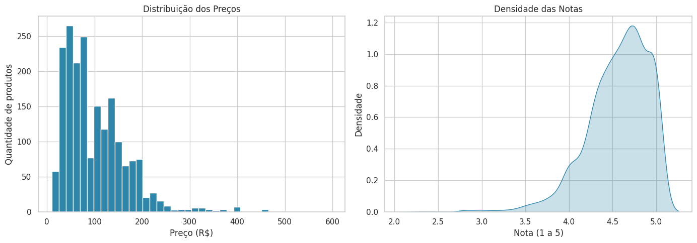
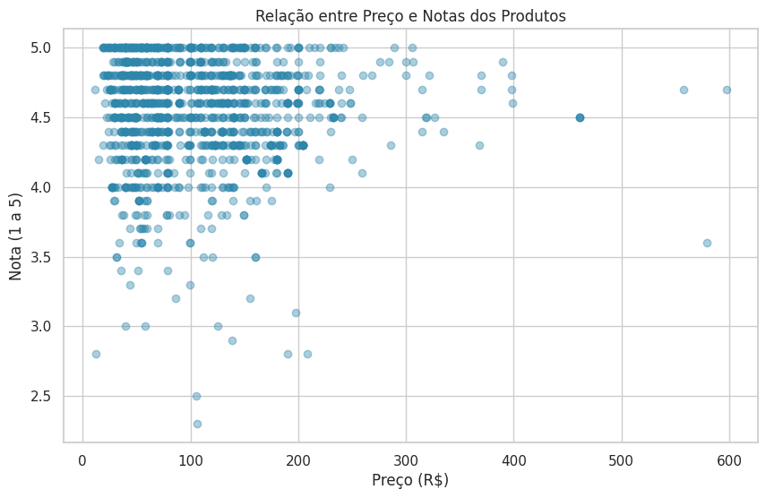
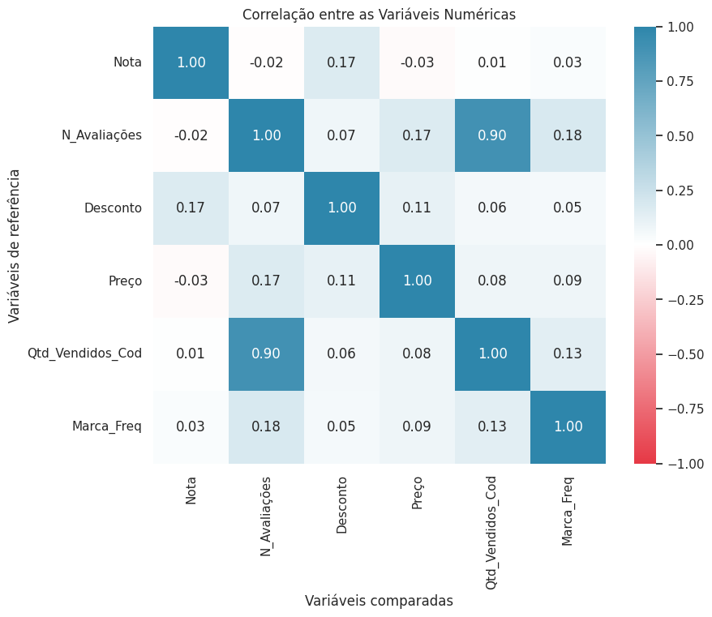
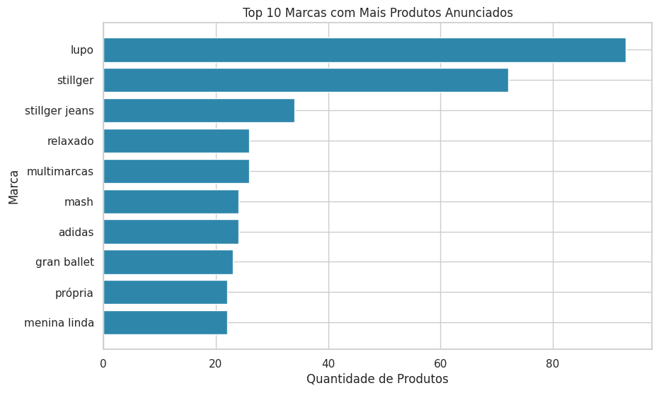
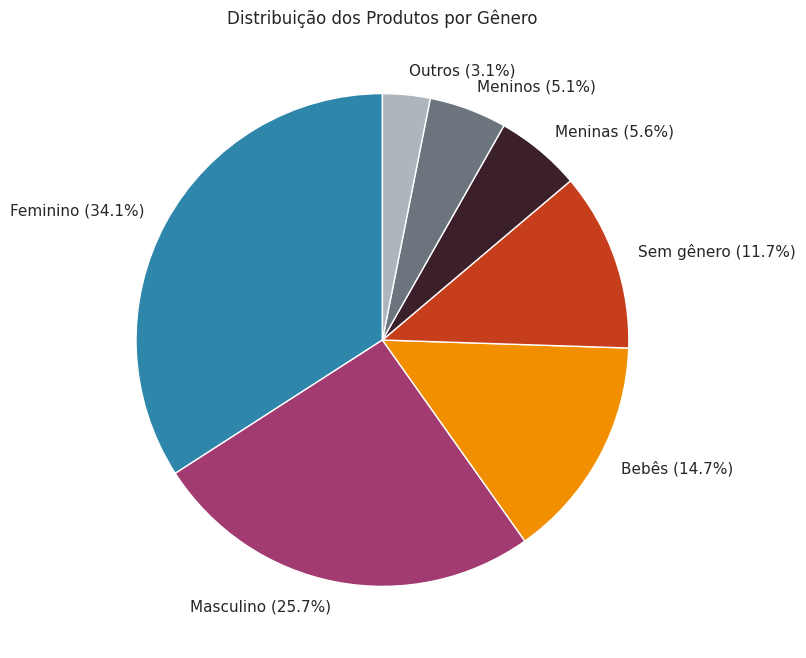
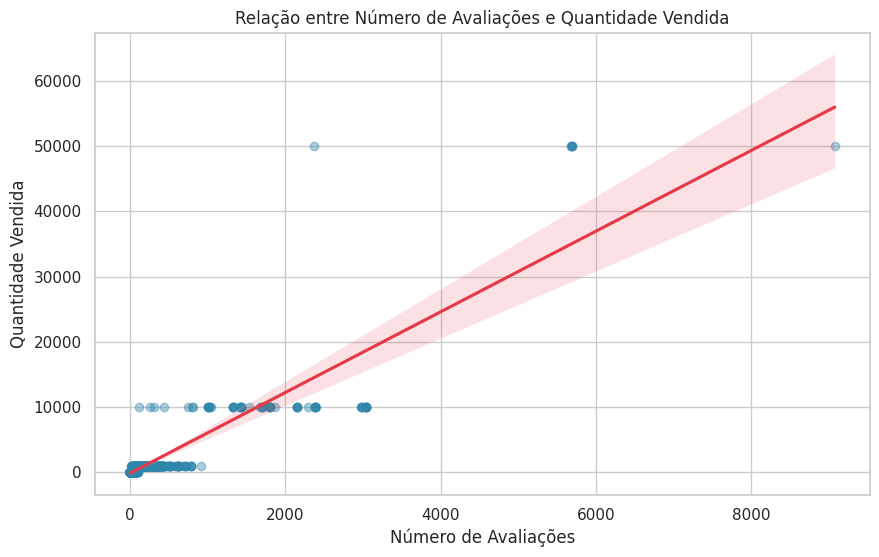

# 📊 Visualização de Dados — E-commerce de Moda

Projeto do **Módulo 10 (Visualização de Dados)** do curso **Profissão: Cientista de Dados da EBAC**.

A partir de uma base com **2.199 produtos** de um e-commerce de roupas (já tratada nos módulos anteriores), o objetivo foi escolher o gráfico certo para cada tipo de informação e destacar os principais achados de forma clara para um cliente.

📓 **Notebook:** [Profissao_Cientista_de_Dados_M10_Pratique.ipynb](Profissao_Cientista_de_Dados_M10_Pratique.ipynb)

---

## 🛠️ Tecnologias

- **Python**
- **Pandas** — leitura e manipulação dos dados
- **Matplotlib** — histograma, dispersão, barras, pizza e grade de gráficos (subplots)
- **Seaborn** — mapa de calor, densidade e regressão
- **Google Colab**

---

## 🔎 Principais achados

| # | Achado |
|---|---|
| 1 | Metade dos produtos custa até **~R$ 79**, e a maioria fica abaixo de **R$ 140** |
| 2 | **Preço não influencia a nota:** produtos caros não são mais bem avaliados (correlação de -0,03) |
| 3 | **Avaliações e vendas andam juntas:** correlação de **0,90**, a mais forte da base |
| 4 | **Lupo** e **Stillger** são as marcas com mais produtos anunciados |
| 5 | O público **feminino** concentra 34% dos produtos, seguido do masculino (26%) e de bebês (15%) |
| 6 | As notas são altas: **95%** dos produtos avaliados têm nota 4 ou mais |

---

## 📈 Gráficos

### Distribuição dos preços e das notas (histograma + densidade)
À esquerda, em quais faixas de preço está a maior parte dos produtos. À direita, as notas se concentram entre 4 e 5, e notas baixas são raras.



### Preço x Nota (dispersão)
A nuvem de pontos sem direção mostra que preço e nota não têm relação.



### Correlação entre as variáveis (mapa de calor)
Destaque para a forte relação entre número de avaliações e quantidade vendida.



### Top 10 marcas (barras)
Marcas com mais produtos anunciados na loja.



### Produtos por gênero (pizza)
Para qual público os produtos são direcionados.



### Avaliações x Vendas (regressão)
A linha de tendência confirma: quanto mais avaliações, mais vendas.



---

## ▶️ Como executar

1. Baixe o notebook e o arquivo `ecommerce_preparados.csv` e deixe os dois na mesma pasta
2. Abra o notebook no Google Colab, Jupyter ou VS Code
3. Execute todas as células

---

## 📁 Estrutura

```
├── Profissao_Cientista_de_Dados_M10_Pratique.ipynb   # notebook com a análise
├── ecommerce_preparados.csv                           # base de dados
├── imagens/                                           # gráficos gerados
└── README.md
```

---

👤 **Murillo Alcantara** — [GitHub](https://github.com/zmurilloxz)
